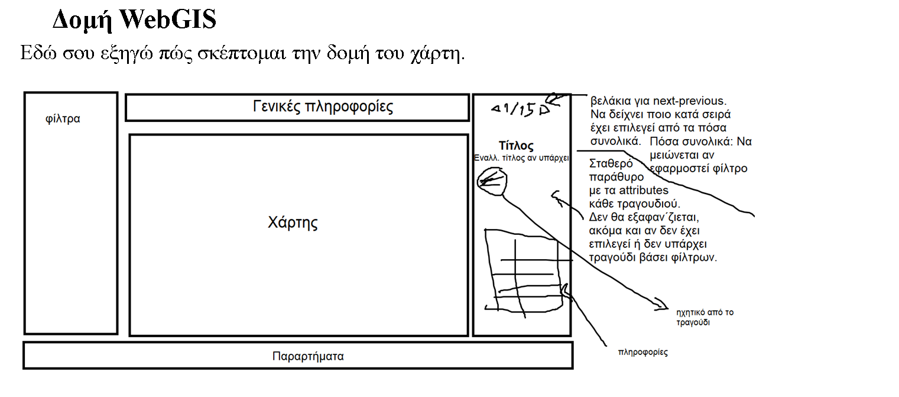

# 01 — Requirements (from Vaggelis' 2026-04-21 email)

> This document reorganizes the email **"Ταξίδι στην Παράδοση"** sent
> by Evangelos Spyrou (`evspyrou@geol.uoa.gr`) to Alexandros Liaskos
> (`alexliaskos@geol.uoa.gr`) on 2026-04-21 at 20:22, together with
> its attachments (`Sketch.png`, `Δεδομένα.zip`, the Thessaloniki song
> spreadsheet, and the typography reference). The original `.msg` file
> stays in the project root and remains the source of truth — this
> document is a structured, reviewable restatement. Where content is
> a direct translation, it is marked *[quote]*; everything else is a
> faithful paraphrase.
>
> **Review instruction for Vaggelis** — please read this and flag
> anything that does not match your intent. Open items are listed in
> [06-open-questions.md](06-open-questions.md).

---

## 1. Project intent

Build a WebGIS that documents Greek musical traditions — a living map
of songs, each anchored to a place and described in enough
scholarly detail that an ethnomusicologist, a student, or a curious
visitor can find what they need. The map is the entry point; the
per-song editorial panel is where the substance lives.

## 2. Guardrails (standing directive)

1. ***[quote]*** *"Do not take initiative if you don't know — ask.
   For example, if you want a list of all available categories or
   regions or villages from the start, don't write them from scratch,
   ask me to provide them. If anything doesn't work generally (GIS,
   texts, structure, etc.), tell me and we'll discuss it."*
2. **No publicity, no sharing, no external communication** about the
   project at this stage.
3. **Hosting** — will sit under Vaggelis' own domain once he finishes
   the domain setup. No action required from the developer for now.
4. **Meetings** — Vaggelis prefers in-person reviews: *"Whenever you
   have questions, let me know and we'll meet — I prefer in person
   to review everything together."*

## 3. Geographic hierarchy

The map works in five tiers:

| Tier | Greek | Geometry | Cardinality vs. song |
|---|---|---|---|
| Region | Περιοχή | MultiPolygon | **Exactly one** per song (required) |
| Sub-region | Υποπεριοχή | MultiPolygon | Zero or one |
| Specific sub-region | Επί μέρους υποπεριοχή *(Vaggelis wants this renamed — see Q1 in [06](06-open-questions.md))* | MultiPolygon | Zero or one |
| Island | Νήσος | MultiPolygon | Zero or one (when applicable) |
| Village | Χωριό | Point | Zero or one |

**Example regions named by Vaggelis** (not exhaustive; he will
provide the complete list): Epirus (Ήπειρος), Peloponnese
(Πελοπόννησος), Ionian Islands (Επτάνησα), Aegean Islands (Νησιά
Αιγαίου), Pontus (Πόντος), Cyprus (Κύπρος), Crete (Κρήτη), Thessaly
(Θεσσαλία), Thrace (Θράκη), … .

**Rules:**
- **Every song must belong to exactly one region.** All other tiers
  are optional.
- A region can have zero or more sub-regions; a sub-region can have
  zero or more specific sub-regions; any region or sub-region can
  contain zero or more islands; villages can attach at any level.
- Specific sub-regions are still being digitized by Vaggelis — the
  system must tolerate an incomplete set and gain rows over time.
- **Codes are unique at each tier and compose into a song code**
  (see §4.1). Codes are **auto-generated, never entered manually**.

## 4. Song metadata — 14 fields

The canonical song record. In the UI, **empty fields are hidden** (never
show labels without values).

### 4.1 `code` — Κωδικός
Unique auto-generated identifier per song, composed from the geography
codes + a sequence number. Form proposed:
`<region_code>[-<subregion_code>][-<specific_subregion_code>]-<seq:3>`.
**Never created manually.** Enforced by a DB trigger on insert.

### 4.2 `title` — Τίτλος
Song name, as Vaggelis records it.

### 4.3 `alt_title` — Εναλλακτικός τίτλος
Optional. Displayed inline with the title in the pattern
`Title………. [Alternative Title……….]` when present.

### 4.4 `region` / `subregion` / `specific_subregion` / `island` / `village`
Per §3. The panel shows only the fields that are set.

### 4.5 `categories` — Κατηγορία
1-to-3 categories per song, **ranked** (primary, secondary, tertiary).
Each category has its own description used as a hover tooltip in the
filter UI — *no page navigation on hover*. The category list is
provided by Vaggelis (do not invent).

### 4.6 `rhythm` — Ρυθμός
Optional. Links to the appendices section without losing the song
context (see §7 on cross-references).

### 4.7 `dance` — Χορός
Optional. Style of dance, where applicable.

### 4.8 `recording_by` — Καταγραφή
Optional. Name of the person who recorded it, if known.

### 4.9 `description` — Περιγραφή
Multi-paragraph narrative. Vaggelis' sample includes paragraph
breaks and soft line-breaks; we store as Markdown and render with a
strict sanitiser.

### 4.10 `lyrics` — Στίχοι
For non-instrumental songs. **Displayed centred, with breathing
space between stanzas.** Stored as Markdown.

### 4.11 `comments` — Σχόλια
Explanations of lyrics where needed. Referenced inline from the
lyrics block.

### 4.12 `information_sources` — Πηγή
Zero or more entries. Each is either a **clickable link**, a
**bibliographic citation**, an **archival reference**, or an
**oral source**; they can coexist. Stored in the child table
`song_information_sources(song_id, kind, value, accessed_at,
display_order)` for FK integrity and per-source audit events.
Links carry an optional `accessed_at` date for scholarly citation.

### 4.13 `audio_source` — Πηγή ήχου
Free-text origin of the recording (collector, archive, radio
programme, field trip, …).

### 4.14 `language` — Γλώσσα
One or more languages (some songs are bilingual). Stored as a
many-to-many junction.

---

### 4.15 Display logic (applies to all fields)

- **Hide empty fields.** No label without a value.
- Vaggelis initially drafted a tabular layout; **we may revise after
  the first interface draft** and he will confirm or redirect.

## 5. Map behaviour

### 5.1 Initial state
- All regions render as coloured polygons.
- Village markers are shown over the regions (user can toggle).

### 5.2 Interaction
- Clicking a region **zooms to that region**, **removes the
  coloured fill** leaving only its border, **hides all other regions**,
  and **reveals its sub-regions, islands, specific sub-regions, and
  villages** as available.
- The user can **toggle visibility** of each sub-layer independently.
- **Map ↔ filter sync is bidirectional.** Selecting a sub-region
  in the filter dropdown should zoom/highlight it on the map, and
  vice-versa.

### 5.3 Visibility principle
Only show entities that are reachable from the current selection.
Example: if the user has chosen *Epirus → Thesprotia*, the map and
filters should expose only the specific sub-regions, islands and
villages inside Thesprotia.

## 6. Filters (right / left panel — in this exact order)

### Geographic
1. **Region** (Περιοχή) — dropdown, **no free-text input**.
2. **Sub-region** (Υποπεριοχή) — text input **and** dropdown.
3. **Specific sub-region** *(renamed)* — text input and dropdown.
4. **Island** (Νήσος) — text input and dropdown.
5. **Village** (Χωριό) — text input and dropdown.

### Song-content
6. **Title** (Τίτλος) — text input and dropdown. When an alt-title
   exists, show as `Title……. [Alternative Title…….]`.
7. **Category** (Κατηγορία) — text input and dropdown, **multi-select
   allowed**. A song matches if **any of its three ranked categories**
   matches the user's selection (primary OR secondary OR tertiary).
8. **Rhythm** (Ρυθμός) — text input and dropdown.
9. **Dance** (Χορός) — text input and dropdown.
10. **Language** (Γλώσσα) — dropdown only, **no free-text input**.

### Full-text
11. **Keywords** (Λέξεις κλειδιά) — free-text only. Searches across
    **description, lyrics, and comments** simultaneously.
    Vaggelis suggested scoping options ("lyrics", "description",
    "both") — decision deferred to Q4 in
    [06-open-questions.md](06-open-questions.md).

## 7. Cross-references between songs (Παραπομπές)

A song can point to another song because of shared melody, shared
rhythm, shared lyrics, or shared theme. In the panel, a
cross-reference is a **clickable link that loads the referenced
song** — the map zooms/updates to the referenced song's location and
the panel swaps contents, **without losing the current geographic
context**. Use song codes to disambiguate (the same title may exist
in several regions).

**Worked example (from the email).** "Brysouda mou trichaminia" ↔
"Karayanina" (similar melody, both *Trechatós* rhythm), parallel
themes with "Brysí mou petrokamári" (Kilkis) and thematic links to
"Malámo" (Roumeli) and "Maroúsa" (Kea).

Modelled as a self-join `song_references(song_id,
referenced_song_id, relation_type, note)`.

## 8. Audio

Vaggelis **prefers hosting audio files directly** rather than
embedding YouTube links. He asks the developer to confirm:

1. Technical feasibility ✔ (Supabase Storage — decided this session)
2. Ability to host full songs (1-10 minutes each) ✔
3. Disk space implications — depends on song count × average size
   (Q3 in [06](06-open-questions.md))
4. YouTube ToS compliance — flagged for our research if we ever
   fall back
5. Naming convention — we propose `<region_code>/<song_code>.mp3`
   (Q2 in [06](06-open-questions.md))

## 9. Sketch and layout (Vaggelis' hand drawing)

The attached hand sketch (`docs/assets/sketch.png`) titled
**"Δομή WebGIS"** ("WebGIS structure") annotates his mental model:

```
┌──────┬──────────────────────────────┬─────────────────────┐
│      │ Γενικές πληροφορίες          │ 11/15   ← → prev/nxt│
│ Φίλτρα│ (general info)              │ Τίτλος              │
│      ├──────────────────────────────┤ Εναλλ. τίτλος…      │
│      │                              │ ┌─────────────────┐ │
│      │                              │ │ attributes of   │ │
│      │                              │ │ this song       │ │
│      │       Χάρτης (map)           │ └─────────────────┘ │
│      │                              │                     │
│      │                              │      πληροφορίες    │
│      │                              │      (info)         │
│      │                              │                     │
│      │                              │   ηχητικό από       │
│      │                              │   το τραγούδι       │
│      │                              │   (audio of song)   │
├──────┴──────────────────────────────┴─────────────────────┤
│ Παραρτήματα (appendices)                                 │
└───────────────────────────────────────────────────────────┘
```

His annotations (translated):
- **Arrows for next/previous** on the song panel.
- The `11/15` counter shows *which song you're on* and *how many
  songs match the current filter*.
- Total count **must decrease** as filters are applied.
- **The song panel is a fixed window with the song's attributes**
  — it does **not disappear** on map zoom, even if the song is no
  longer selected or filtered out. The user can always get back.



### Restated as a wireframe flow



*Rendered: [public-layout.svg](assets/public-layout.svg) · [public-layout.png](assets/public-layout.png) · source: [diagrams/public-layout.mmd](diagrams/public-layout.mmd)*

## 10. What Vaggelis explicitly asked us to decide

Cross-referenced to [06-open-questions.md](06-open-questions.md):

- **Q1** — Rename for *Επί μέρους υποπεριοχή* (Specific sub-region).
- **Q2** — Audio file naming convention.
- **Q3** — Disk/Storage budget sized to song count × length.
- **Q4** — Keyword-search scope toggle (unified vs. per-field).
- **Q5** — Audio hosting approach (**resolved this session: Supabase
  Storage**).
- **Q6** — Layout / tabular vs. panel presentation after the first
  draft.

## 11. Attachments referenced

| File | Content |
|---|---|
| `Sketch.png` | Layout drawing (shown above) |
| `Δεδομένα.zip` | Geographic base data (polygons + points) — 7.1 MB |
| `τραγούδια Θεσσαλονίκης για Αλέξανδρο.xlsx` | Sample song sheet for Thessaloniki (38 KB) |
| `webgis-typography.md` | Editorial typography system — preserved at `_archive/` and adapted in [04-typography.md](04-typography.md) |
