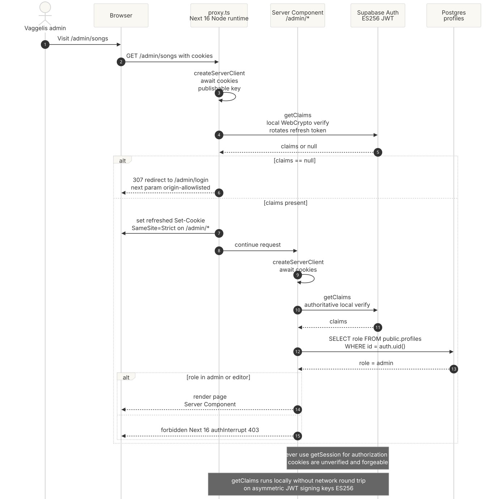
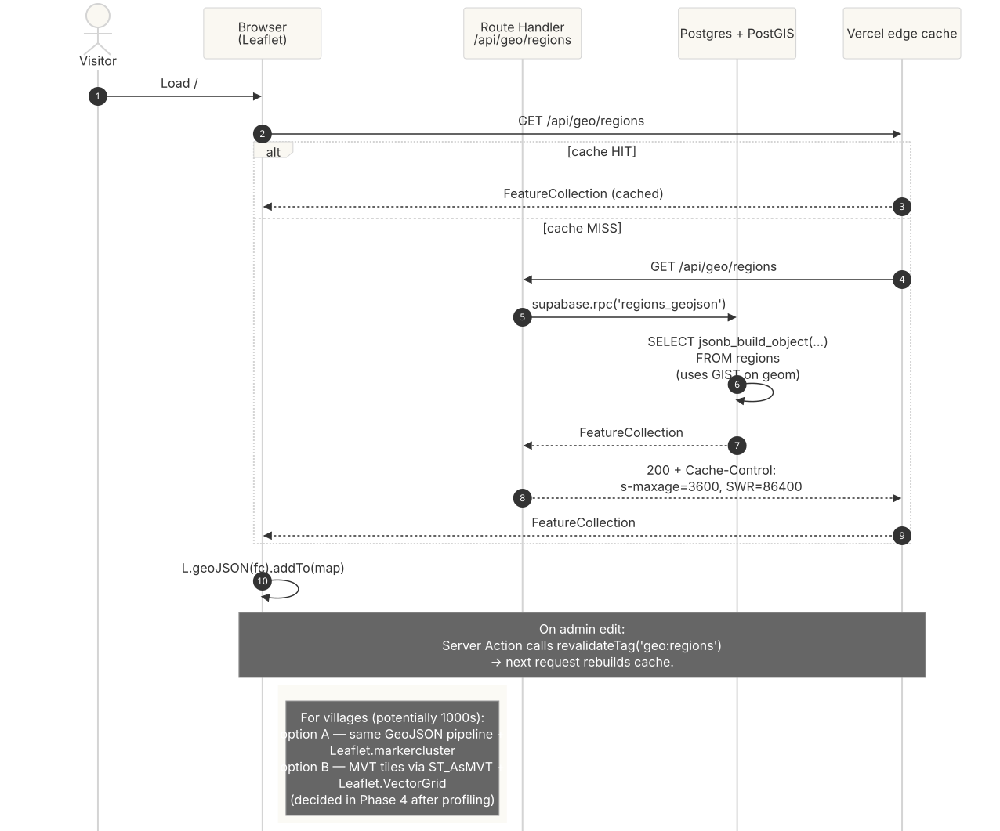

# 02 — Architecture

> How the pieces fit together. Accompanies
> [01-requirements.md](01-requirements.md) (the *what*) and
> [03-er-diagram.md](03-er-diagram.md) (the *data*).

---

## 1. System overview

Three layers. Everything we care about lives on Supabase; the Next.js
app and Vercel are the delivery pipe.



*Rendered: [architecture.svg](assets/architecture.svg) · [architecture.png](assets/architecture.png) · source: [diagrams/architecture.mmd](diagrams/architecture.mmd)*

## 2. Auth



*Rendered: [auth-flow.svg](assets/auth-flow.svg) · [auth-flow.png](assets/auth-flow.png) · source: [diagrams/auth-flow.mmd](diagrams/auth-flow.mmd)*

### Flow (`@supabase/ssr` + Next.js 16)

1. **Proxy** — `proxy.ts` (the file formerly called `middleware.ts`;
   Next.js 16 renamed it) runs on every request on the **Node runtime**.
   It calls `createServerClient(…)` with cookie read/write handlers
   wired to the `NextRequest` / `NextResponse` pair, then calls
   `supabase.auth.getClaims()` to trigger refresh-token rotation and
   write the new cookies onto the response. Protected paths
   (`/admin/*`) redirect to `/admin/login` when claims are null.
2. **Server Components** (pages and layouts) call
   `createServerClient(…)` with `await cookies()` from `next/headers`
   (cookies/headers/params are hard-async in Next 16), **omitting
   `setAll`** (Server Components cannot set cookies). For
   authorization, we **always** use `supabase.auth.getClaims()` —
   never `getSession()`, because session cookies are not verified
   by the Auth server and a malicious client could forge them.
3. **Route Handlers** and **Server Actions** call
   `createServerClient(…)` with both `getAll` and `setAll` (they can
   write cookies on the outgoing response). Server Actions that
   need the **secret key** (mutations) run a *separate* admin
   client from `lib/supabase/admin.ts` — see §4.
4. **Browser code** (`"use client"`) uses `createBrowserClient(…)`,
   which reads session from cookies and talks to PostgREST with the
   **publishable key** only. Browser code **does not mutate** — see
   §4.

**Why `getClaims()` and not `getUser()`.** Since late 2025 Supabase
projects use **asymmetric JWT signing keys** (ES256 by default).
`getClaims()` verifies the JWT **locally via WebCrypto**, no network
round trip — the default in the current Supabase Next.js quickstart.
`getUser()` still contacts the Auth server for every call and is
reserved for flows where server-side freshness is required (e.g.
immediately after a password/email change or revocation). For
request-time authorization, `getClaims()` is the right tool.

### Magic-link hardening (threat model)

The admin sign-in surface is email magic links. Mandatory hardening:

- **PKCE flow, not implicit.** `@supabase/ssr` ≥ 0.5 defaults to
  PKCE with a token hash confirmation route
  (`/auth/confirm?token_hash=…&type=email`). This defeats
  link-prewarmers (corporate mail scanners that burn the token
  before the user clicks) and browser-switching attacks.
- **Origin-locked `next` redirect.** `/admin/login?next=…` values
  are validated against an allow-list of safe prefixes (`/admin/`,
  `/`, `/songs/`). Anything else is rejected to prevent the
  open-redirect class of bugs.
- **`SameSite=Strict`** on Supabase auth cookies for `/admin/*`
  paths. No public cross-site navigation enters admin.
- **Rate limits (concrete).** `/admin/login` OTP request: 5 per
  email per hour, 20 per IP per hour, 100 globally per hour
  (tunable in the Supabase dashboard; enforced by Upstash Redis on
  our edge for per-IP fine-graining).
- **hCaptcha / Turnstile** on `/admin/login` if we observe abuse;
  architecture ready, not enabled by default.
- **MFA** — Supabase TOTP is GA. Enabled-by-default for any
  account with `role = 'admin'`; enforcement check in the proxy.
  Until Vaggelis enrols, he uses email-link only and we accept the
  single-factor risk in writing (see `docs/08-privacy-and-terms.md`).
- **No self-signup to admin.** New signups land with
  `role = 'viewer'`. Admin role is granted only via a one-off SQL
  executed by the developer at bootstrap or manually through the
  admin UI by an existing admin (promote flow). There is no
  reachable code path that escalates a `viewer` to `admin`
  automatically.

### Roles

```
auth.users        (managed by Supabase)
      │ 1:1
      ▼
public.profiles
  id uuid PK  (FK auth.users.id ON DELETE CASCADE)
  full_name text
  role app_role NOT NULL DEFAULT 'viewer'   -- 'admin' | 'editor' | 'viewer'
  mfa_enrolled boolean NOT NULL DEFAULT false
  created_at timestamptz NOT NULL DEFAULT now()
```

- `admin` — Vaggelis, Alex. Full CRUD on content and Storage via
  Server Actions.
- `editor` — reserved for future collaborators. Can create + edit
  songs but not delete or change schema-ish tables (regions,
  categories).
- `viewer` — default for any newly signed-up account. No admin UI
  access.

RLS predicates never call `auth.uid()` per row. They call a
`STABLE SECURITY DEFINER` function `public.app_current_role()` that
wraps the lookup; the function pins `search_path = ''` (Supabase
advisor compliance) and schema-qualifies every identifier. See
[`03-er-diagram.md` §6](03-er-diagram.md#6-rls-matrix) for the DDL.

## 3. Reads — RLS is the gate

Public pages use the **publishable key** (`sb_publishable_...`) in a
browser-ish server client. Policies on every content table:
`FOR SELECT TO anon, authenticated USING (true)` — anyone can read.
Storage's `audio` bucket is public-read.

**Why this is safe.** The data is a published archive; nothing in it
is secret. RLS + public-read is the right default.

### Performance notes
- Every policy **names its target role** with `TO anon` / `TO
  authenticated` / `TO service_role`. This is the single biggest
  RLS performance lever — policies only evaluate when the role
  matches.
- Wrap `auth.uid()` in `(SELECT auth.uid())` in every policy (and
  in the `app_current_role()` helper). Hoists the call out of
  per-row evaluation.
- `app_current_role()` is `STABLE SECURITY DEFINER` with
  `search_path = ''`; it caches once per statement.
- `GIST` index on every geometry column (`regions.geom`,
  `villages.geom`, …).
- Use Postgres **`EXPLAIN (ANALYZE, BUFFERS)`** in CI on the top-10
  public queries. Fail the build if p95 planning+execution crosses
  150 ms on seeded data.
- Run the Supabase schema advisor (`supabase_advisor` checks) in
  CI; fail on "Function Search Path Mutable" or "RLS disabled".

## 4. Writes — Server Actions, not client

**All mutations go through Next.js Server Actions on the Node
runtime.** The Server Action opens a supabase client with the
**secret key** (`sb_secret_...`; never leaves the server), performs
the write after checking `app_current_role() IN ('admin','editor')`,
and returns. The client never writes directly.

```ts
// app/(admin)/songs/actions.ts
'use server'
export const runtime = 'nodejs'  // secret key MUST NOT run on Edge

import { admin } from '@/lib/supabase/admin'        // 'server-only' module
import { requireRole } from '@/lib/auth'            // throws if not admin
import { CreateSongSchema } from '@/lib/schemas'
import { revalidateTag, updateTag } from 'next/cache'

export async function createSongAction(input: unknown) {
  await requireRole('admin')
  const data = CreateSongSchema.parse(input)
  const { data: song, error } = await admin.from('songs').insert(data).select().single()
  if (error) throw error
  await logEdit({ actor: /* user.id */, action: 'create', entity: 'song', entity_id: song.id, diff: { after: data } })
  updateTag(`song:${song.code}`)                    // read-your-writes for the admin
  revalidateTag('geo:songs', 'max')                 // SWR invalidation for the public
  return song
}
```

Rationale (from Supabase + Next.js production experience):
- RLS is hard to reason about when it carries the whole weight of
  authorization for mutations; policies grow, edge cases leak,
  secret-key back-doors creep in.
- Server Actions give us one chokepoint for audit logging, input
  validation (Zod), revalidation (`revalidateTag`), and
  read-your-writes (`updateTag`).
- Write policies on tables are **`TO service_role` only** — no
  authenticated/anon grants for INSERT/UPDATE/DELETE at all. Even
  a misrouted authenticated client cannot write. This is the
  belt-and-suspenders layer.

### Runtime, CSRF, and key leakage guards

- `lib/supabase/admin.ts` is marked `"server-only"` (Vercel will
  fail the build if it imports into a client bundle) and includes
  a runtime guard: `if (typeof window !== 'undefined') throw`.
- `export const runtime = 'nodejs'` on every Server Action file
  that touches the secret key. Never run these on Edge.
- **CSRF.** Next.js Server Actions use an encrypted action id
  regenerated per build; that is our first layer. Second layer:
  Supabase auth cookies set `SameSite=Strict` on `/admin/*`
  (see §2) so cross-origin form submission is blocked. Third
  layer: `assertSameOrigin(headers())` helper called at the top
  of every mutating action.
- **Build-time leak check.** A CI step greps `.next/static/**`
  for the strings `sb_secret_`, `SUPABASE_SECRET_KEY`, `eyJ` — any
  hit fails the build.

## 5. Storage (audio)

- Bucket: `audio`. **Public read**, admin write. **Smart CDN
  enabled** (auto-invalidation on edit, ~60 s global propagation).
- Path convention: `<region_code>/<song_code>.<ext>`. Enumerable
  by design — consistent with the "public archive" framing. ADR
  0004 accepts this explicitly.
- Upload path: client browser POSTs `{ song_id }` (not filename)
  to a Server Action → the Server Action looks up the song's
  region_code + code, computes the path **server-side** (clients
  cannot choose paths), calls `createSignedUploadUrl` via the
  secret key → returns the signed URL → client `PUT`s directly to
  Storage. The secret key never ships to the browser.
- Default bucket limit: **15 MB per file** (128 kbps × 15 min
  headroom); admins can override per-song for higher-fidelity
  masters.
- Only `mp3`, `m4a`, `ogg` accepted (MIME + magic-bytes check on
  the Server Action).

### Byte-range streaming — the risk we've already priced in

Supabase Storage's byte-range behaviour on signed URLs has a
history of edge cases that still bite iOS Safari / `AVPlayer`
(`discussions/35866`). **Phase 9 gate**: an automated test
exercises a ≥20 MB MP3 on iOS Safari + Chrome + Firefox + a bare
`curl -I -H "Range: bytes=0-"` and checks `Accept-Ranges: bytes`.
If the gate fails, the fallback plan is already wired:

**Fallback: Cloudflare R2.**
- S3-compatible — the upload Server Action switches to the AWS
  SDK's `S3Client` with R2 credentials; no client changes.
- Zero egress — attractive if the archive ever gets popular.
- Custom domain (e.g. `audio.journey-to-tradition.el`) via R2's
  built-in domain or Cloudflare's CDN.
- Migration path: `rclone sync` from Supabase Storage to R2 once;
  swap the public URL base; keep Postgres rows identical
  (`audio_path` is just a key).

**Disaster recovery for audio**. Storage is NOT in Supabase's PITR.
We run a nightly `rclone sync audio/` to Backblaze B2 (cheap,
boring, S3-compatible). Details in
[docs/10-backup-and-dr.md](10-backup-and-dr.md).

## 6. Map data pipeline

### Regions + sub-regions + specific sub-regions + islands
These are **small** datasets — order of ~10 regions, a few dozen
sub-regions, a few dozen islands. Small enough to serve as GeoJSON.



*Rendered: [map-data-flow.svg](assets/map-data-flow.svg) · [map-data-flow.png](assets/map-data-flow.png) · source: [diagrams/map-data-flow.mmd](diagrams/map-data-flow.mmd)*

Server-side SQL:
```sql
SELECT jsonb_build_object(
  'type', 'FeatureCollection',
  'features', jsonb_agg(
    jsonb_build_object(
      'type', 'Feature',
      'geometry', ST_AsGeoJSON(geom)::jsonb,
      'properties', jsonb_build_object('id', id, 'name_el', name_el, 'code', code)
    )
  )
) FROM public.regions;
```

Caching uses Next.js 16 **Cache Components** (unified model — PPR +
dynamicIO + the old `unstable_cache`):

```ts
// app/api/geo/regions/route.ts
import 'server-only'
import { cacheLife, cacheTag } from 'next/cache'

async function getRegionsFC() {
  'use cache'
  cacheTag('geo:regions')
  cacheLife('max')
  const { data } = await sb.rpc('regions_geojson')
  return data
}
```

When the admin Server Action edits a region:

```ts
import { updateTag, revalidateTag } from 'next/cache'
updateTag('geo:regions')                    // read-your-writes for the admin UI
revalidateTag('geo:regions', 'max')         // SWR invalidation for public viewers
```

**Cache keys**: `geo:regions`, `geo:subregions`,
`geo:specific_subregions`, `geo:islands`, `geo:villages`. Each
Route Handler response includes an `ETag` derived from
`max(updated_at)` so proxies and the browser can short-circuit on
matching versions.

### Villages
**Deferred decision — Phase 4.** Two candidate paths:
- **A.** Same GeoJSON trick (fine up to ~5k points with
  `Leaflet.markercluster`).
- **B.** Vector tiles via `ST_AsMVT` exposed through a Route Handler
  (`/api/tiles/villages/{z}/{x}/{y}.pbf`) and rendered with
  `Leaflet.VectorGrid`. Needed only if village count explodes.

We profile with the real `Δεδομένα.zip` count before committing.

### Base layer
OpenStreetMap raster tiles (free, no API key). License attribution
in the map footer. Fall-back: Carto Light positron (also free for
low volume).

## 7. Full-text search (keywords filter)

Postgres FTS with the `greek` language config **wrapped in
`unaccent()`** so diacritic variants (βρύση ↔ βρυση, πολυτονικό ↔
μονοτονικό) fold into the same term. Without `unaccent`, folk-lyric
search misses almost every dialectal form — the `greek` config
tokenizes but does not fold diacritics.

Generated `tsvector` column on `songs`:

```sql
-- 00_extensions.sql (runs via `supabase db push`)
create extension if not exists postgis     with schema extensions;
create extension if not exists pg_trgm     with schema extensions;
create extension if not exists unaccent    with schema extensions;

-- 04_tables_songs.sql
alter table public.songs add column search_vec tsvector
  generated always as (
    setweight(to_tsvector('greek', unaccent(coalesce(title_el,''))),       'A') ||
    setweight(to_tsvector('greek', unaccent(coalesce(alt_title_el,''))),   'B') ||
    setweight(to_tsvector('greek', unaccent(coalesce(description_md,''))), 'C') ||
    setweight(to_tsvector('greek', unaccent(coalesce(lyrics_md,''))),      'C') ||
    setweight(to_tsvector('greek', unaccent(coalesce(comments_md,''))),    'D')
  ) stored;

create index songs_search_idx on public.songs using gin (search_vec);
```

Query-side must mirror the transform:
```sql
SELECT id, code, title_el, ts_rank(search_vec, q) AS rank
FROM public.songs, plainto_tsquery('greek', unaccent($1)) q
WHERE search_vec @@ q
ORDER BY rank DESC
LIMIT 50;
```

**Quality gate in Phase 2.** Run 10 probe queries dictated by
Vaggelis against the real Thessaloniki XLSX sample; eyeball
precision/recall. If `greek` + `unaccent` + `pg_trgm` trigram
substring match does not hit the bar, escalate to a custom text
search config (`pg_catalog.simple` + custom stop-words +
`dict_thesaurus`) before P10.

## 8. Client-side architecture

- **Server-first.** Pages are Server Components by default. Client
  islands are marked explicitly.
- **State sharing** — the map, the filters, and the song panel
  share one URL-synced state (query params like
  `?region=EPE&sub=THS&cat=KLF&q=bryso…`). That keeps the map↔filter
  sync **declarative** and makes every view bookmarkable and
  shareable.
- We use the App Router's `useSearchParams()` + `router.replace()`
  (shallow) in the client components; Server Components read the
  same params via `searchParams` props to render server-fetched
  content.
- One global store only for the ephemeral UI — current song index
  inside the filtered set, "panel pinned" flag. Zustand is fine.

## 9. Testing boundaries

- **Unit** — pure functions only (filter assembly, code generation
  logic, Markdown sanitization rules). Vitest.
- **DB/RLS** — local Supabase (`supabase start`) seeded with
  `supabase/seed.sql`; policy tests written as SQL + `pgTAP` or
  Node test harness that impersonates auth.
- **E2E** — Playwright hitting local dev + local Supabase. Flows:
  filter → pick song → read panel, admin login → edit polygon,
  upload audio.
- **No mocks of Supabase.** Local instance instead. Mocks drift
  from real behaviour in subtle ways, especially around RLS and
  storage.

## 10. Dev-prod parity

- Same Postgres version (16) locally and in Supabase cloud.
- Same extensions: **`postgis`**, **`pg_trgm`** (trigram fuzzy
  matching), **`unaccent`** (Greek diacritic folding for FTS).
  Installed via SQL migration (`00_extensions.sql`) — hosted
  Supabase grants the necessary privileges.
- Same Supabase API key model — **publishable + secret** on both
  environments from day 1; legacy `anon`/`service_role` JWTs are
  never generated.
- Migrations live in `supabase/migrations/*.sql` and run in order
  both locally (`supabase db reset`) and on deploy (`supabase db
  push`).
- Seeds live in `supabase/seed.sql` (structural seed; Vaggelis'
  real content loads via `pnpm import:data` and is never checked in).
- TypeScript types for the DB are generated by `pnpm gen:types`
  (`supabase gen types typescript --local`) into `lib/db/schema.ts`.

## 11. Performance budgets

| Metric | Target | Measurement |
|---|---|---|
| First Contentful Paint (desktop) | < 1.5 s | Lighthouse CI (median of 3 runs) |
| Largest Contentful Paint (3G Fast) | < 3.0 s | Lighthouse CI + Vercel Speed Insights RUM |
| Cumulative Layout Shift | < 0.05 | Lighthouse CI + RUM |
| Time-to-Interactive (3G Fast) | < 5.0 s | Lighthouse CI |
| p95 public query latency | < 150 ms | pg_stat_statements + Supabase dashboard |
| p95 Server Action (admin) | < 400 ms | Vercel + OpenTelemetry |
| Map 60 FPS (panning, all regions) | required | Chrome DevTools Performance panel fixture |
| Audio TTFB (Storage CDN) | < 300 ms | Synthetic check from three regions |
| Lighthouse Performance score (mobile) | ≥ 90 | CI gate, blocking merge |
| Lighthouse Accessibility score | ≥ 95 | CI gate, blocking merge |

Lighthouse CI configured in `.github/workflows/lhci.yml`; runs on
every PR against the Vercel preview URL. Budgets in
`lighthouserc.json`.

## 12. Security checklist (pre-prod)

### Database / RLS
- [ ] RLS enabled on every public-schema table (`ALTER TABLE …
      ENABLE ROW LEVEL SECURITY`).
- [ ] Every policy names a target role (`TO anon` / `TO
      authenticated` / `TO service_role`).
- [ ] Mutations are **`TO service_role` only** — no INSERT/UPDATE/
      DELETE grants to `anon` or `authenticated`.
- [ ] `app_current_role()` pins `search_path = ''` and
      schema-qualifies identifiers.
- [ ] Supabase advisor (`supabase_advisor` checks) runs in CI
      and is green; no "Function Search Path Mutable" warnings.

### Keys and secrets
- [ ] Only **publishable** (`sb_publishable_...`) and **secret**
      (`sb_secret_...`) API keys in use — no legacy JWT anon /
      service_role keys generated.
- [ ] Secret key referenced only from server-only modules
      (`lib/supabase/admin.ts` with `"server-only"` import).
- [ ] CI greps `.next/static/**` for `sb_secret_`,
      `SUPABASE_SECRET_KEY`, and JWT prefixes (`eyJ`); any hit
      fails the build.
- [ ] Runtime guard in `admin.ts`:
      `if (typeof window !== 'undefined') throw`.

### Storage
- [ ] `audio` bucket public-read with Smart CDN on; no other
      buckets are public.
- [ ] Byte-range streaming verified on iOS Safari with a 20 MB
      MP3 (Phase 9 gate).
- [ ] Backup job (nightly `rclone sync` to B2) green in the last
      7 days (see [10-backup-and-dr.md](10-backup-and-dr.md)).

### Network / headers
- [ ] CORS: only the production domain whitelisted on
      Supabase REST/Storage.
- [ ] CSP configured in `next.config.ts` headers:
  ```
  default-src 'self';
  script-src 'self' 'nonce-{NONCE}' 'strict-dynamic';
  style-src 'self' 'unsafe-inline';
  img-src 'self' data: blob: https://*.tile.openstreetmap.org
          https://*.supabase.co;
  media-src 'self' https://*.supabase.co;
  connect-src 'self' https://*.supabase.co;
  frame-ancestors 'none';
  base-uri 'self';
  form-action 'self';
  ```
  `style-src 'unsafe-inline'` is required for Leaflet layer
  styling; Trusted Types is deferred to Phase 11.
- [ ] HSTS, `Referrer-Policy: strict-origin-when-cross-origin`,
      `X-Content-Type-Options: nosniff`, `Permissions-Policy:
      camera=(), microphone=(), geolocation=(self)` set by Next
      `headers()` config.

### CSRF
- [ ] Supabase auth cookies `SameSite=Strict` on `/admin/*` paths.
- [ ] Every mutating Server Action calls
      `assertSameOrigin(headers())` at the top.

### Rate limiting (concrete targets, Upstash Redis)
| Endpoint | Limit |
|---|---|
| `/admin/login` magic-link request | 5 / email / hr · 20 / IP / hr · 100 global / hr |
| `/api/geo/*` | 120 rps / IP |
| `/api/tiles/*` | 300 rps / IP (if MVT enabled) |
| Server Actions (admin) | 60 / user / minute |
| `/api/search` keyword queries | 30 rps / IP |

### Input
- [ ] Every Server Action validates input with a Zod schema from
      `lib/schemas/*`.
- [ ] Markdown rendering runs `rehype-sanitize` with the allow-list
      in [11-content-policy.md](11-content-policy.md). 20 XSS
      fixtures (`<script>`, `onerror`, `javascript:`, `data:`, SVG
      foreign-object, encoded entities) render as inert text in a
      unit test.

### Supply chain
- [ ] `pnpm audit --prod` clean (no high/critical).
- [ ] Dependabot enabled; patch updates auto-merge after CI green.
- [ ] `pnpm.onlyBuiltDependencies` allow-list used (pnpm 10+).

### Auth
- [ ] PKCE flow on magic links; open-redirect allow-list verified.
- [ ] MFA enforced for `role = 'admin'` once Vaggelis enrols.
- [ ] No self-signup path reaches `admin` role.

## 13. Observability

- **Log aggregation** — Axiom (free tier sufficient). Vercel logs
  + Supabase logs (via Logflare drain) + Sentry breadcrumbs all
  flow into one dataset, queryable in APL.
- **Errors** — Sentry (free tier) for client + server. PII
  scrubber configured to redact `description_md`, `lyrics_md`,
  `comments_md` content from breadcrumbs. Source maps uploaded
  on every Vercel build.
- **Metrics / RUM** — Vercel Speed Insights (privacy-preserving,
  cookieless) for Core Web Vitals.
- **Analytics** — Vercel Analytics (cookieless, GDPR-safe).

### SLOs

| SLI | Target | Window |
|---|---|---|
| Public availability (2xx / 3xx on `/`, `/songs/*`) | ≥ 99.5 % | 30 days rolling |
| p95 public query latency | < 150 ms | 7 days rolling |
| p95 Server Action latency | < 400 ms | 7 days rolling |
| Audio playback success (first-byte within 2 s) | ≥ 99 % | 30 days rolling |

Alerts fire to a Slack webhook shared by Vaggelis + Alex when any
SLI drops below target for > 5 min (fast-burn) or > 1 h
(slow-burn).

### Runbooks (in `docs/runbooks/`, populated Phase 11)

- `supabase-down.md` — what to do when Supabase has an incident
- `storage-5xx-spike.md` — byte-range regression / CDN issue
- `magic-link-not-arriving.md` — SMTP / DKIM / DMARC
- `db-full.md` — WAL / disk full, graceful degradation
- `rollback-deploy.md` — Vercel promote-previous + DB migration
  revert

---

## 14. Backup and disaster recovery

Full details in [docs/10-backup-and-dr.md](10-backup-and-dr.md).
Summary:

- **Postgres PITR** — Supabase Pro, 7-day window.
- **Weekly `pg_dump`** — full logical dump to Backblaze B2,
  retained 1 year.
- **Nightly `rclone sync`** of the `audio/` Storage bucket to
  Backblaze B2, retained 30 days.
- **Quarterly DR test** — restore into a staging Supabase project,
  run the Playwright smoke suite. Without a tested restore,
  backups are theoretical.
- **Archive export** — `pnpm export:archive` produces a
  self-contained zip (`data.sql` + `audio/` + `edits.jsonl` +
  `README.md`) that Vaggelis could hand to a successor. Runs
  nightly into the same B2 bucket.
- **RPO 24 h, RTO 4 h** — the archive is not latency-critical;
  recovery can take hours not minutes.
