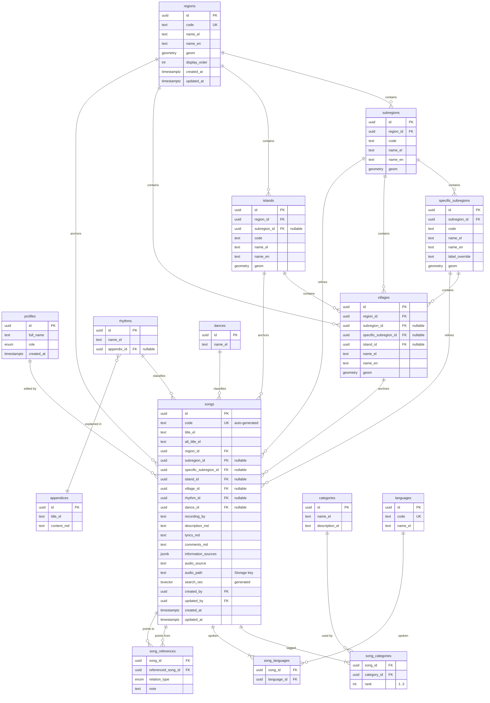

# 03 — ER diagram, table specs, RLS matrix

> The data model behind the WebGIS. Read alongside
> [01-requirements.md](01-requirements.md) (the field semantics) and
> [02-architecture.md](02-architecture.md) (how this data is served
> and written).

---

## 1. ER diagram



*Rendered: [er-diagram.svg](assets/er-diagram.svg) · [er-diagram.png](assets/er-diagram.png) · source: [diagrams/er-diagram.mmd](diagrams/er-diagram.mmd)*



## 2. Table specs (authoritative)

### 2.1 `profiles`
Extends `auth.users`; one row per authenticated account.

| Column | Type | Notes |
|---|---|---|
| `id` | `uuid` **PK** | FK `auth.users.id`, `ON DELETE CASCADE` |
| `full_name` | `text NOT NULL` | Display name |
| `role` | `app_role NOT NULL DEFAULT 'viewer'` | enum: `admin`, `editor`, `viewer` |
| `mfa_enrolled` | `boolean NOT NULL DEFAULT false` | TOTP enrolment flag; enforced for admins |
| `created_at` | `timestamptz NOT NULL DEFAULT now()` | |
| `updated_at` | `timestamptz NOT NULL DEFAULT now()` | touched by trigger |

**Trigger.** On `auth.users` insert, insert a matching `profiles`
row with `role='viewer'`. Vaggelis and Alex are bumped to `admin`
by a one-off SQL seeded during P0. No UI path promotes a `viewer`
to `admin` — promotions happen via a Server Action callable only
by existing admins.

### 2.2 `regions`, `subregions`, `specific_subregions`, `islands` — polygon tiers

Shared shape across the four tables (child FKs differ):

| Column | Type | Notes |
|---|---|---|
| `id` | `uuid PK DEFAULT gen_random_uuid()` | |
| `code` | `text NOT NULL` | short unique ID (e.g. `EPE`, `THS`). **UK within tier** (and globally across tiers in practice) |
| `name_el` | `text NOT NULL` | Greek name |
| `name_en` | `text` | English gloss, optional |
| `geom` | `geometry(MultiPolygon, 4326) NOT NULL` | |
| `display_order` | `int NOT NULL DEFAULT 0` | user-controlled sort |
| parent FKs | per tier (see ER diagram) | `ON DELETE RESTRICT` — deleting a parent with children errors |
| `created_at` / `updated_at` | `timestamptz NOT NULL DEFAULT now()` | touched by trigger |

**Indexes.** GIST on `geom`; btree on `(code)` and all FKs.

**`specific_subregions.label_override`** — free-text that overrides
the tier label in the UI *for that row only*. Lets Vaggelis address
Q1 (rename "specific sub-region") without a schema migration.

### 2.3 `villages`

| Column | Type | Notes |
|---|---|---|
| `id` | `uuid PK` | |
| `region_id` | `uuid NOT NULL` | FK `regions.id` |
| `subregion_id` | `uuid` | FK `subregions.id`, nullable |
| `specific_subregion_id` | `uuid` | FK, nullable |
| `island_id` | `uuid` | FK `islands.id`, nullable |
| `name_el` | `text NOT NULL` | |
| `name_en` | `text` | |
| `geom` | `geometry(Point, 4326) NOT NULL` | |
| `created_at` / `updated_at` | `timestamptz` | |

**Constraint.** At least `region_id` is set (enforced by column NULLability).

### 2.4 `songs`

| Column | Type | Notes |
|---|---|---|
| `id` | `uuid PK` | |
| `code` | `text NOT NULL UNIQUE` | **auto-generated** (see trigger) |
| `title_el` | `text NOT NULL` | |
| `alt_title_el` | `text` | |
| `region_id` | `uuid NOT NULL` | FK `regions.id` |
| `subregion_id` | `uuid` | FK, nullable |
| `specific_subregion_id` | `uuid` | FK, nullable |
| `island_id` | `uuid` | FK, nullable |
| `village_id` | `uuid` | FK, nullable |
| `rhythm_id` | `uuid` | FK `rhythms.id`, nullable |
| `dance_id` | `uuid` | FK `dances.id`, nullable |
| `recording_by` | `text` | free text |
| `description_md` | `text` | Markdown, rendered through strict sanitizer |
| `lyrics_md` | `text` | Markdown, centred in UI |
| `comments_md` | `text` | Markdown |
| `information_sources` | `jsonb NOT NULL DEFAULT '[]'` | array of `{type:'link'\|'bibliography', value:text}` |
| `audio_source` | `text` | free text (collector/archive/radio/…) |
| `audio_path` | `text` | Storage key (`<region_code>/<code>.mp3`) |
| `audio_license` | `audio_license NOT NULL DEFAULT 'uncleared'` | see [11-content-policy.md](11-content-policy.md) |
| `audio_license_note` | `text` | attribution / rights-holder details |
| `search_vec` | `tsvector GENERATED` | `setweight`s of `to_tsvector('greek', unaccent(coalesce(field,'')))` — see [02-architecture.md §7](02-architecture.md#7-full-text-search-keywords-filter) |
| `version` | `int NOT NULL DEFAULT 1` | optimistic-lock version; Server Actions enforce `WHERE version = $expected` |
| `created_by` / `updated_by` | `uuid` | FK `profiles.id` |
| `created_at` / `updated_at` | `timestamptz` | |

**Code trigger** — on insert, compute:
```
code := region.code
     || coalesce('-' || subregion.code, '')
     || coalesce('-' || specific_subregion.code, '')
     || '-' || lpad(nextval(format('songs_seq_%s', region.id))::text, 3, '0')
```

Per-region sequences prevent hotspot contention on a single global
sequence. The trigger creates the sequence lazily if missing.

### 2.5 `song_categories`
| Column | Type | Notes |
|---|---|---|
| `song_id` | `uuid NOT NULL` | FK `songs.id`, `ON DELETE CASCADE` |
| `category_id` | `uuid NOT NULL` | FK `categories.id`, `ON DELETE RESTRICT` |
| `rank` | `int NOT NULL CHECK (rank BETWEEN 1 AND 3)` | |
| **PK** | `(song_id, rank)` | one category per rank slot |
| **UK** | `(song_id, category_id)` | same category cannot be ranked twice |

### 2.6 `song_languages`
`(song_id, language_id)` — both FK, **PK** on the pair.

### 2.7 `song_references`
| Column | Type | Notes |
|---|---|---|
| `song_id` | `uuid NOT NULL` | FK `songs.id`, `ON DELETE CASCADE` |
| `referenced_song_id` | `uuid NOT NULL` | FK `songs.id`, `ON DELETE CASCADE` |
| `relation_type` | `song_relation_type NOT NULL` | enum: `melodic`, `rhythmic`, `lyrical`, `thematic` |
| `note` | `text` | optional free-text explaining the relation |
| **PK** | `(song_id, referenced_song_id, relation_type)` | |
| **Check** | `song_id <> referenced_song_id` | no self-reference |

**Directionality.** Edge is directed. If Vaggelis wants bidirectional
display on both songs' panels, the admin UI silently writes the
reverse edge too (or the read query UNIONs both directions). Decision
deferred to Phase 9.

### 2.8 `categories`, `rhythms`, `dances`, `languages`, `appendices`

Small lookup tables. `categories.description_el` holds the hover
tooltip text Vaggelis asked for on the filter UI.

### 2.9 `song_information_sources` (promoted from jsonb)

| Column | Type | Notes |
|---|---|---|
| `id` | `uuid PK DEFAULT gen_random_uuid()` | |
| `song_id` | `uuid NOT NULL` | FK `songs.id`, `ON DELETE CASCADE` |
| `kind` | `info_source_kind NOT NULL` | enum: `link`, `bibliography`, `archival`, `oral` |
| `value` | `text NOT NULL` | URL, citation, or free text |
| `accessed_at` | `date` | access date for links (scholarly requirement) |
| `display_order` | `int NOT NULL DEFAULT 0` | stable ordering in the panel |

**Why a child table instead of `songs.information_sources jsonb`.**
FK integrity, individual indexing, single-row audit events when
one source is added, and clean ordering. The Server Action that
writes a song plus its sources does so in one transaction.

### 2.10 `edits` (audit log — append-only)

Written by every Server Action that mutates content.

| Column | Type | Notes |
|---|---|---|
| `id` | `uuid PK DEFAULT gen_random_uuid()` | |
| `actor_id` | `uuid NOT NULL` | FK `profiles.id` |
| `action` | `edit_action NOT NULL` | enum: `create`, `update`, `delete`, `import`, `promote`, `demote` |
| `entity_type` | `text NOT NULL` | `song`, `region`, `category`, `rhythm`, `dance`, `language`, `appendix`, `song_reference`, `profile`, … |
| `entity_id` | `uuid` | may be null for bulk import rows |
| `entity_code` | `text` | the stable code when available (e.g. song code) |
| `diff` | `jsonb NOT NULL` | shape: `{ before: object\|null, after: object\|null, fields_changed: text[] }` — validated by Zod + CHECK |
| `ip_hash` | `text` | SHA-256 of IP + monthly salt (not raw IP) |
| `user_agent` | `text` | truncated to 200 chars |
| `batch_id` | `uuid` | groups rows from one import |
| `created_at` | `timestamptz NOT NULL DEFAULT now()` | |

**Indexes.**
- `(entity_type, entity_id, created_at DESC)` — history view.
- `(actor_id, created_at DESC)` — activity per admin.
- `(batch_id)` — audit bulk imports.

**RLS.** `admin` SELECT only. No UPDATE / DELETE from anyone —
table is append-only. `service_role` INSERT only.

**Retention.** 2 years minimum; longer on request. Not part of the
`pnpm export:archive` unless the owner opts in (it may include
other collaborators' identifiers once `editor` role exists).

### 2.11 `geometry_edits` (geometry audit — Rule #1 for polygons)

Snapshots the previous geometry before an admin save, enabling
"undo last edit" and investigating boundary disputes.

| Column | Type | Notes |
|---|---|---|
| `id` | `uuid PK DEFAULT gen_random_uuid()` | |
| `actor_id` | `uuid NOT NULL` | FK `profiles.id` |
| `entity_type` | `geo_entity_type NOT NULL` | `region`, `subregion`, `specific_subregion`, `island`, `village` |
| `entity_id` | `uuid NOT NULL` | the polygon's id |
| `before_geom` | `geometry NOT NULL` | the previous shape |
| `after_geom` | `geometry NOT NULL` | the new shape |
| `note` | `text` | admin-entered reason |
| `created_at` | `timestamptz NOT NULL DEFAULT now()` | |

**Indexes.** `(entity_type, entity_id, created_at DESC)`; GIST on
`before_geom` and `after_geom` (for spatial diff audits).

**RLS.** `admin` SELECT + INSERT; append-only (no UPDATE/DELETE).

## 3. Custom enums

```sql
create type public.app_role            as enum ('admin','editor','viewer');
create type public.song_relation_type  as enum ('melodic','rhythmic','lyrical','thematic');
create type public.info_source_kind    as enum ('link','bibliography','archival','oral');
create type public.audio_license       as enum (
  'public_domain', 'cc_by', 'cc_by_sa', 'cc_by_nc', 'cc_by_nc_sa',
  'all_rights_reserved', 'uncleared'
);
create type public.edit_action         as enum (
  'create', 'update', 'delete', 'import', 'promote', 'demote'
);
create type public.geo_entity_type     as enum (
  'region', 'subregion', 'specific_subregion', 'island', 'village'
);
```

## 4. Views

### 4.1 `v_geographies` — one flat list for search + pickers
```sql
create or replace view v_geographies as
  select id, 'region'              as tier, code, name_el, name_en, geom from regions
  union all
  select id, 'subregion'           as tier, code, name_el, name_en, geom from subregions
  union all
  select id, 'specific_subregion'  as tier, code, name_el, name_en, geom from specific_subregions
  union all
  select id, 'island'              as tier, code, name_el, name_en, geom from islands
  union all
  select id, 'village'             as tier, null as code, name_el, name_en, geom from villages;
```

### 4.2 `v_song_summary` — what the panel needs in one row
Pre-joins songs with region/subregion/island/village names + the
first category — avoids N+1 when rendering the song list.

## 5. Indexes (summary)

- **GIST** on every `geom` column.
- **GIN** on `songs.search_vec` (full-text).
- **btree** on every FK column.
- **btree UNIQUE** on every `code` column.
- **trigram** (`pg_trgm`) GIN on `songs.title_el` and
  `villages.name_el` to power fuzzy matching in the dropdown-text
  hybrid filters.

## 6. RLS matrix

Legend: ✅ allow, ✋ explicit deny, — no policy needed.
**Writes** are exclusively `TO service_role` — the `anon` and
`authenticated` roles have **no direct INSERT/UPDATE/DELETE
grants** on content tables. All writes come from Server Actions
using the **secret key** (which connects as `service_role`). See
[ADR 0005](adrs/0005-mutations-via-server-actions.md).

| Table | SELECT `TO anon` | SELECT `TO authenticated` | Mutations `TO service_role` |
|---|---|---|---|
| `profiles` | ✋ | ✅ (self only) | ✅ |
| `regions` | ✅ | ✅ | ✅ |
| `subregions` | ✅ | ✅ | ✅ |
| `specific_subregions` | ✅ | ✅ | ✅ |
| `islands` | ✅ | ✅ | ✅ |
| `villages` | ✅ | ✅ | ✅ |
| `categories` | ✅ | ✅ | ✅ |
| `rhythms` | ✅ | ✅ | ✅ |
| `dances` | ✅ | ✅ | ✅ |
| `languages` | ✅ | ✅ | ✅ |
| `appendices` | ✅ | ✅ | ✅ |
| `songs` | ✅ | ✅ | ✅ |
| `song_information_sources` | ✅ | ✅ | ✅ |
| `song_categories` | ✅ | ✅ | ✅ |
| `song_languages` | ✅ | ✅ | ✅ |
| `song_references` | ✅ | ✅ | ✅ |
| `edits` | ✋ | ✋ (admins via Server Action helper, not RLS) | ✅ (INSERT only; UPDATE/DELETE revoked) |
| `geometry_edits` | ✋ | ✋ | ✅ (INSERT + SELECT by admins via Server Action) |

**Canonical policy shape** (applies to every content table):

```sql
-- Reads: open
create policy "public_select"
  on public.regions
  for select
  to anon, authenticated
  using (true);

-- Writes: service_role only. No 'authenticated' grants.
create policy "sr_insert"
  on public.regions
  for insert
  to service_role
  with check (true);

create policy "sr_update"
  on public.regions
  for update
  to service_role
  using (true)
  with check (true);

create policy "sr_delete"
  on public.regions
  for delete
  to service_role
  using (true);
```

**Note on policy syntax.** Postgres `CREATE POLICY` takes one of
`ALL | SELECT | INSERT | UPDATE | DELETE`; a comma-separated list
is invalid. Always split per-verb unless `FOR ALL` is intentional.
`FOR INSERT` uses only `WITH CHECK`; `FOR UPDATE` uses both
`USING` and `WITH CHECK`; `FOR DELETE` uses only `USING`.

### Application-layer authorization helper

The Server Actions themselves call `public.app_current_role()` via
a wrapper:

```ts
// lib/auth.ts
export async function requireRole(required: 'admin' | 'editor'): Promise<void> {
  const { data: role } = await sb.rpc('app_current_role')
  if (!role || (required === 'admin' && role !== 'admin')) {
    throw forbidden()   // Next.js 16 authInterrupts
  }
  if (required === 'editor' && !['admin','editor'].includes(role)) {
    throw forbidden()
  }
}
```

**Helper function (DB side)** — renamed from `current_role` (which
collides with a Postgres built-in), schema-qualified everywhere,
`search_path = ''` for search-path-injection hardening:

```sql
create or replace function public.app_current_role()
  returns public.app_role
  language sql
  stable
  security definer
  set search_path = ''
as $$
  select p.role
  from public.profiles p
  where p.id = (select auth.uid())
$$;
```

This function is used only inside SELECT policies when we need
per-user filtering in future (e.g. editor-specific dashboards);
it is **not** used to gate writes, since writes are `TO
service_role` and do not reach RLS predicates at all.

## 7. Storage policies (bucket `audio`)

```sql
-- Public read
create policy "audio public read" on storage.objects
  for select
  using (bucket_id = 'audio');

-- Admin write
create policy "audio admin write" on storage.objects
  for insert
  using    (bucket_id = 'audio' and current_role() = 'admin')
  with check (bucket_id = 'audio' and current_role() = 'admin');

create policy "audio admin update" on storage.objects
  for update
  using    (bucket_id = 'audio' and current_role() = 'admin')
  with check (bucket_id = 'audio' and current_role() = 'admin');

create policy "audio admin delete" on storage.objects
  for delete
  using (bucket_id = 'audio' and current_role() = 'admin');
```

## 8. Migration ordering (Phase 1 scaffolding)

All migrations run via `supabase db push` — **no manual dashboard
step required** on hosted Supabase. Supabase grants the `postgres`
role privileges to create the extensions we need.

1. `00_extensions.sql` — `postgis` (schema `extensions`),
   `pg_trgm`, `unaccent`, `pgcrypto`.
2. `01_enums.sql` — every enum in §3.
3. `02_functions.sql` — `public.app_current_role()` (see §6),
   `public.assert_version(...)` (optimistic lock), the `updated_at`
   auto-touch trigger function.
4. `03_tables_lookup.sql` — `categories`, `rhythms`, `dances`,
   `languages`, `appendices`.
5. `04_tables_geography.sql` — `regions` → `subregions` →
   `specific_subregions` → `islands` → `villages`.
6. `05_tables_auth.sql` — `profiles`, the `on_auth_user_created`
   trigger.
7. `06_tables_songs.sql` — `songs`, `song_information_sources`,
   `song_categories`, `song_languages`, `song_references`, the
   code-generation trigger, the `search_vec` generated column.
8. `07_views.sql` — `v_geographies`, `v_song_summary`,
   `v_song_neighbours`.
9. `08_rls.sql` — enable RLS on every table, create all policies
   (per-verb, `TO` role targeted).
10. `09_storage.sql` — `audio` bucket + public-read + admin-write
    policies.
11. `10_audit.sql` — `edits`, `geometry_edits` tables + their RLS
    + the audit-insert-only policies.
12. `11_indexes.sql` — every btree / GIN / GIST index not covered
    above.

**PostGIS note.** On hosted Supabase, `create extension postgis
with schema extensions;` runs from a migration file with no extra
steps — the `supabase_admin` role that runs migrations has the
necessary privileges. The older "superuser required" error only
applies to unmanaged Postgres installations.
