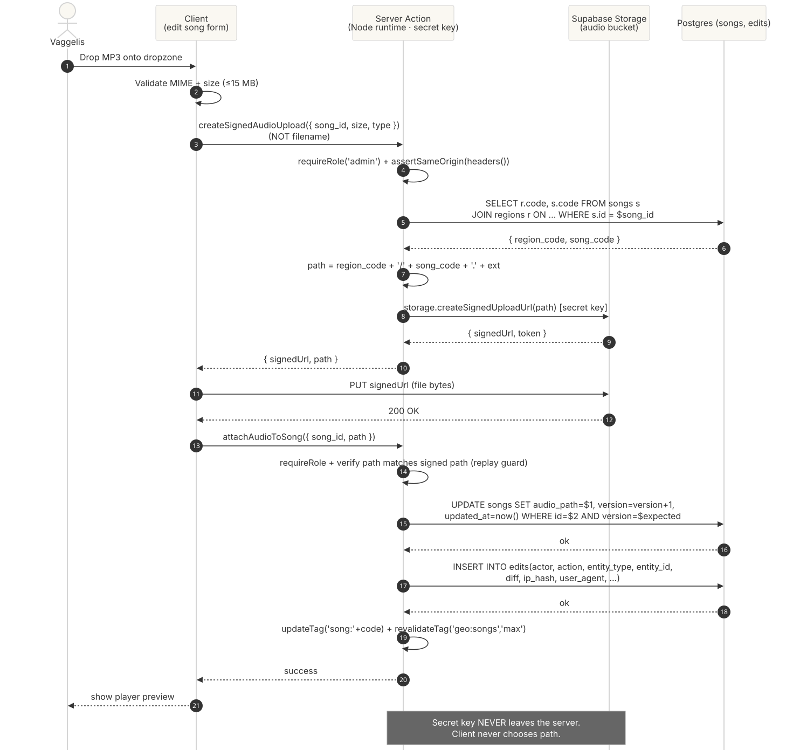

# 05 — Admin UX

> The pages Vaggelis (and future editors) use to maintain the
> archive without touching code. He controls every content decision;
> we own technical correctness.

---

## Goals

1. **Vaggelis-first** — forms and flows match the language in his
   2026-04-21 email. Field labels are Greek. Validation messages
   are Greek. Error-handling explains things the way an
   ethnomusicologist would want to hear them (never leak stack
   traces).
2. **No-accident writes** — every destructive action has an undo
   grace period or a modal confirmation. Never hot-key away a
   region polygon.
3. **Progressive disclosure** — the daily path (edit a song) is one
   click from `/admin`; rare paths (rename a tier, reshape a
   polygon) live deeper.

---

## Page map

```
/admin/login
/admin                        ← dashboard
/admin/songs                  ← list + filters + bulk import
/admin/songs/new              ← create form
/admin/songs/[id]             ← edit form
/admin/regions                ← list + drawer editor
/admin/subregions
/admin/specific-subregions
/admin/islands
/admin/villages
/admin/categories
/admin/rhythms
/admin/dances
/admin/languages
/admin/appendices
/admin/references             ← song_references browser
/admin/import                 ← XLSX + ZIP bulk import
/admin/activity               ← audit log of edits
```

All `/admin/*` routes go through `proxy.ts` (Next.js 16's renamed
middleware) on the Node runtime — unauthenticated requests redirect
to `/admin/login?next=<origin-allowlisted path>`. Pages further
check `role IN ('admin','editor')` in the layout via
`requireRole()`.

---

## `/admin/login`

- One input: email. Submit → `signInWithOtp({ email })`.
- Copy: *"Θα σου στείλουμε έναν σύνδεσμο στο email σου."* ("We'll
  send a link to your email.")
- On callback (`/auth/callback`), redirect to the original URL (or
  `/admin`).

Why magic link (not password): Vaggelis doesn't need another
password to remember, and we avoid password-reset surface area.

---

## `/admin` — dashboard

Cards in a 12-column grid:

- **Τραγούδια σύνολο** — count of songs, with a weekly delta.
- **Τελευταίες επεξεργασίες** — last 10 edits with author, song,
  timestamp; click → jump to song edit form.
- **Εκκρεμότητες** — songs missing audio, songs missing lyrics,
  songs missing a category. Click → filtered list.
- **Ανέβασμα** — quick action buttons: "Νέο τραγούδι", "Εισαγωγή από Excel".
- **Χάρτης κάλυψης** — small Leaflet with one dot per song
  (region-aggregated), visual confirmation that Vaggelis' edits
  landed.

---

## `/admin/songs` — the main list

- **Columns** — `code`, `title`, region/subregion chain,
  categories, rhythm, has-audio dot, has-lyrics dot, updated_at.
- **Filters** — mirror the public filter order from §6 of
  [01-requirements.md](01-requirements.md). Add admin-only filters:
  missing audio, missing lyrics, missing category, has-warnings.
- **Bulk actions** — export selected to XLSX, assign category to
  selected.
- **Row click** → `/admin/songs/[id]`.
- **New button** top-right.

---

## `/admin/songs/[id]` — edit form

Tabs:
1. **Βασικά** — title, alt title, geography pickers (cascading
   from region down), rhythm, dance, language(s), recording.
2. **Κείμενα** — description, lyrics, comments — three
   Markdown editors with preview (MDXEditor or tiptap-md).
3. **Κατηγορίες** — three rank slots (1, 2, 3), each a
   Combobox picking a category (or `none`). Vaggelis cannot type
   a new category here — he creates those in `/admin/categories`.
4. **Πηγές** — links / bibliography entries, add/remove rows.
5. **Ήχος** — drag-and-drop MP3 upload (see §audio flow below),
   player preview, `audio_source` text field.
6. **Παραπομπές** — song_references editor: pick another song,
   pick `relation_type` (melodic / rhythmic / lyrical / thematic),
   optional note.

Bottom bar: **Αποθήκευση** (save), **Ακύρωση** (cancel),
**Διαγραφή** (delete — opens confirmation modal with the song code
typed to confirm).

**Draft vs. publish** — not needed at v1. Vaggelis' mental model is
"if it's in the system, it's the current state". We can revisit if
he wants to stage edits before they go live.

### Audio upload flow



*Rendered: [audio-upload.svg](assets/audio-upload.svg) · [audio-upload.png](assets/audio-upload.png) · source: [diagrams/audio-upload.mmd](diagrams/audio-upload.mmd)*

1. User drops an MP3 / M4A / OGG. Client checks MIME and size
   client-side (≤ 15 MB default).
2. Client POSTs `{ song_id, size, type }` to Server Action
   `createSignedAudioUpload`. **Filename is not sent** — the
   client never chooses the Storage path.
3. Server Action:
   1. `requireRole('admin')`.
   2. Loads the song's `region_code` + `code` from the DB.
   3. Derives the path: `<region_code>/<code>.<ext>` (ext from
      the validated MIME).
   4. Calls `storage.from('audio').createSignedUploadUrl(path)`
      using the **secret-key client**.
   5. Returns `{ signedUrl, path }`.
4. Client PUTs the file to the signed URL.
5. Client POSTs `{ song_id, path }` to Server Action
   `attachAudioToSong` which re-verifies the role, validates the
   path matches what was signed (replay protection), updates
   `songs.audio_path`, writes an `edits` row, and calls
   `updateTag("song:"+code)` + `revalidateTag("geo:songs", "max")`.
6. Panel preview refreshes.

**Why the Server Action sandwich:** the **secret key** never leaves
the server, and we keep a single chokepoint for validation (max
duration, max size, region-exists, MIME check, filename-never-from-
client). See [02-architecture.md §4](02-architecture.md#4-writes--server-actions-not-client).

---

## `/admin/regions` (and the four polygon tiers)

Left pane: searchable list of regions.
Right pane: a Leaflet map with **leaflet-geoman** armed.

Actions:
- **Draw new polygon** — geoman pencil tool → Vaggelis traces → save → Server Action persists `geom` as `ST_GeomFromGeoJSON`.
- **Edit existing polygon** — click a row → polygon enters edit mode (vertex handles) → drag / add / remove vertices → save.
- **Delete** — row menu → confirm modal with the region code typed
  to confirm.
- **Rename** (text) — inline edit for `name_el`, `name_en`, `code`.

Because we change `geom`, wrap the save call in a transaction:
1. `BEGIN`;
2. `UPDATE regions SET geom = $1, updated_at = now(), updated_by = $uid WHERE id = $2`;
3. `INSERT INTO edits(...)` (audit trail — see `/admin/activity`);
4. `COMMIT`.

On success: `revalidateTag('geo:regions')` so the public map
refreshes.

### Safety net for geometry edits

- Before overwrite, snapshot the previous `geom` into an
  `geometry_edits` audit table with the diff (Rule #1 applied to
  the DB).
- "Undo last edit" button in the region row menu restores from
  audit.

---

## `/admin/categories`

- Simple list with inline edit (`name_el`, `description_el` — the
  hover tooltip text that shows in the public filter UI).
- Add button → inline form.
- Delete requires zero songs linked (policy); otherwise suggests
  merging into another category first.

`/admin/rhythms`, `/admin/dances`, `/admin/languages`, `/admin/appendices`
— same pattern. `rhythms` extra field: `appendix_id`
(dropdown of appendices).

---

## `/admin/import` — bulk import

This is our critical improvement on Vaggelis' "send me data" loop.
He can drop his own files and watch them land.

**Supported files:**
- **XLSX** with one row per song. Template mirrors
  `τραγούδια Θεσσαλονίκης για Αλέξανδρο.xlsx` column order, with
  validation messages for unknown regions / categories / rhythms.
- **ZIP** containing polygon GeoJSON/Shapefile + a manifest.

**Flow:**
1. Upload → Server Action stores in a temp Supabase Storage folder.
2. **Preview step** — parses the file, shows a table of the first
   N rows with resolvable references highlighted green and
   unresolvable ones red (with a suggestion: "Region 'Ρούμελη' not
   found — create it? or map to 'Στερεά Ελλάδα'?").
3. **Dry-run step** — server runs the full import inside
   `BEGIN … ROLLBACK`, captures all errors, returns the list.
4. **Commit** — user clicks, the same code runs without rollback.
5. **Audit entry** with the file name, row counts, success/fail.

**Idempotency** — each row has a stable `external_id` so a re-upload
upserts rather than duplicates.

---

## `/admin/references` — cross-reference browser

A graph-style explorer for the `song_references` table.

- Left: song picker.
- Right: the picked song's references (outgoing) and back-references
  (incoming), grouped by `relation_type`.
- Click any neighbour to jump.
- "Add reference" button → modal: pick a song, pick a relation,
  add an optional note.

No need for full graph visualization at v1 — Vaggelis will use this
sparingly during curation.

---

## `/admin/activity` — audit log

A chronological feed of every mutating action, powered by an
`edits` table written by every Server Action:

| Column | Purpose |
|---|---|
| `id` | |
| `actor_id` → `profiles.id` | who did it |
| `action` | `create` / `update` / `delete` / `import` |
| `entity_type` | `song` / `region` / `category` / … |
| `entity_id` | uuid |
| `diff` | jsonb `{ before, after }` |
| `created_at` | |

Filterable by actor, entity type, date. Every row links to the
affected entity (or, if deleted, shows the deleted snapshot).

---

## Input validation (all forms)

- **Zod** schemas in `lib/schemas/*.ts`, imported by both the client
  form (for live validation) and the Server Action (for server
  validation).
- Markdown fields pass through **rehype-sanitize** on save.
- Geometry fields validate with `ST_IsValid(geom)` before accepting.
- Audio uploads reject on `content-type` mismatch + size overflow.

---

## Keyboard / accessibility

- `/admin` nav uses real links (no `onClick` to navigate).
- Forms are keyboard-navigable; every field has a `<label>`.
- Error states: `aria-invalid` + `aria-describedby`.
- Modal dialogs use `<dialog>` element or Radix Dialog.
- Colour contrast ≥ 4.5:1 on every text over surface
  (hairline-grey text is only used on non-essential info).
- `prefers-reduced-motion` disables panel slide-in animations.

---

## Wireframe reference

Vaggelis' original sketch (focused on the public map, not admin)
lives at [`docs/assets/sketch.png`](assets/sketch.png) and is
embedded in [01-requirements.md](01-requirements.md#9-sketch-and-layout-vaggelis-hand-drawing).
Admin wireframes — none yet; we'll iterate in Phase 7 on Vercel
previews.
